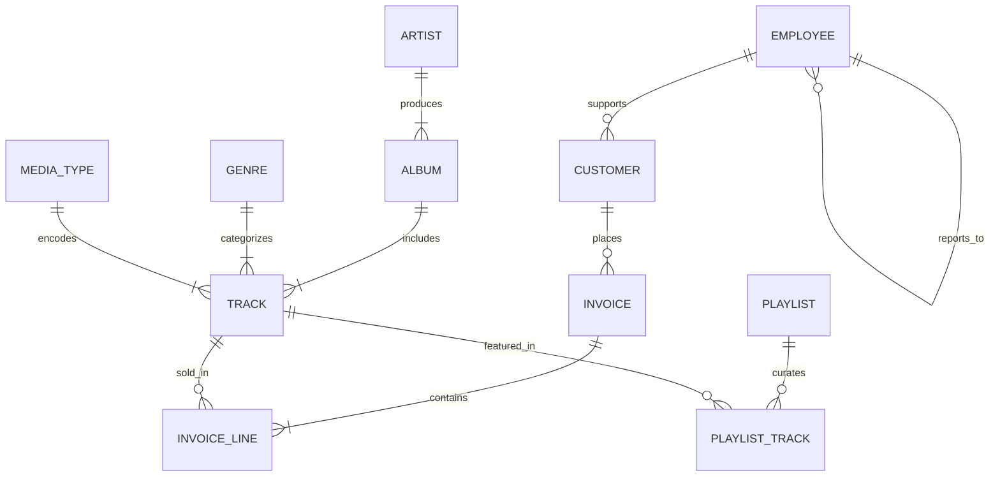

# 🎵 Music Store Business Analytics using SQL


---

## 📌 Executive Summary

This project delivers an end-to-end commercial and customer analytics evaluation of a multinational digital music store. Using an **11-table normalized relational database (3NF)** spanning **3,500+ track records** and **18,300+ total operational records**, this analysis addresses strategic business challenges across:
- **Global Event Marketing**: Identifying high-density, revenue-maximizing cities to host live promotional music festivals.
- **Catalog Strategy & Artist Footprint**: Evaluating rock genre dominance and track length distributions.
- **Customer Lifetime Value (CLV) Tiering**: Segmenting customers into clear loyalty tiers (**Platinum, Gold, Silver, Bronze**) using Common Table Expressions (CTEs) and window functions (`DENSE_RANK`).
- **Customer Retention & Business Growth**: Tracking monthly sales growth trajectory and calculating customer retention and repeat purchase rates.
- **Cross-Border Taste Preferences**: Mapping country-specific musical genre affinity using window functions (`DENSE_RANK`).

---

## 🏗️ Database Architecture & Relational Schema (11 Tables)

The database models a global digital media retail operation, normalized into **Third Normal Form (3NF)** to eliminate redundancy and uphold referential integrity:



### Table Inventory & Scale Verification

| Table Name | Description | Key Attributes | Record Count |
| :--- | :--- | :--- | :---: |
| **`track`** | Core music catalog items | Track ID, Name, Genre, Album, Milliseconds, Price | **3,503** |
| **`playlist_track`** | Playlist-to-track many-to-many junction | Composite (Playlist ID, Track ID) | **8,715** |
| **`invoice_line`** | Itemized purchased order units | Line ID, Invoice ID, Track ID, Unit Price, Qty | **4,757** |
| **`invoice`** | Commercial transaction headers | Invoice ID, Customer ID, Invoice Date, Total | **614** |
| **`album`** | Studio and live albums | Album ID, Title, Artist ID | **347** |
| **`artist`** | Musical artists and bands | Artist ID, Name | **275** |
| **`customer`** | Global registered accounts | Customer ID, Country, Email, Support Rep ID | **59** |
| **`genre`** | Musical styles & categories | Genre ID, Name | **25** |
| **`playlist`** | Curated playlist collections | Playlist ID, Name | **18** |
| **`employee`** | Internal sales & management staff | Employee ID, Reports To, Level, Title | **9** |
| **`media_type`** | Audio encoding formats | Media Type ID, Name | **5** |
| **TOTAL** | **Consolidated Relational Data Records** | | **18,327** |

---

## 💡 Core Analytical Modules & Business Insights

### 1. Revenue-Maximizing Cities for Promotional Music Events
* **Business Question**: Which global city generates the highest cumulative spend and order concentration to host a regional promotional music festival?
* **Analytical Method**: Multi-table `INNER JOIN` across `customer` and `invoice`, aggregating gross revenue and Average Order Value (AOV).
* **Key Finding**: **Prague, Czech Republic** ranks #1 globally, generating **$273.24** across **30 orders** with an AOV of **$9.11**, outpacing Mountain View ($169.29) and London ($166.32).

```sql
SELECT 
    i.billing_city,
    i.billing_country,
    COUNT(DISTINCT i.customer_id) AS unique_customers,
    COUNT(i.invoice_id) AS total_orders,
    ROUND(SUM(i.total), 2) AS total_revenue,
    ROUND(AVG(i.total), 2) AS avg_order_value
FROM invoice i
GROUP BY i.billing_city, i.billing_country
ORDER BY total_revenue DESC
LIMIT 5;
```

---

### 2. Catalog Strategy & Top Rock Artists
* **Business Question**: Who are the primary catalog anchors in Rock music, and which listeners should be targeted for live event campaigns?
* **Analytical Method**: 4-table `INNER JOIN` (`artist` ➔ `album` ➔ `track` ➔ `genre`) with subquery audience extraction.
* **Key Finding**: **Led Zeppelin** leads the catalog with **114 rock tracks**, followed by **U2 (112 tracks)**, **Deep Purple (92 tracks)**, and **Iron Maiden (81 tracks)**. Rock listeners account for the largest single genre audience across the store.

```sql
SELECT 
    ar.artist_id,
    ar.name AS artist_name,
    COUNT(t.track_id) AS total_rock_tracks
FROM track t
INNER JOIN album al ON t.album_id = al.album_id
INNER JOIN artist ar ON al.artist_id = ar.artist_id
INNER JOIN genre g ON t.genre_id = g.genre_id
WHERE g.name = 'Rock'
GROUP BY ar.artist_id, ar.name
ORDER BY total_rock_tracks DESC
LIMIT 5;
```

---

### 3. Customer Lifetime Value (CLV) & Loyalty Tiers (`DENSE_RANK`)
* **Business Question**: How is customer spend distributed across our base, and how can we rank customers and establish loyalty tiers?
* **Analytical Method**: Common Table Expression (CTE) combined with `DENSE_RANK()` window function to rank spenders and `CASE WHEN` to assign tiers.
* **Key Finding**:
  - **Platinum Tier ($100+)**: Top high-value spenders drive disproportionately high revenue and average $106+ in spend.
  - Ranking customers with `DENSE_RANK()` ensures transparent, fair ordinal placement without skipping ranks.

```sql
WITH customer_clv AS (
    SELECT 
        c.customer_id,
        CONCAT(c.first_name, ' ', c.last_name) AS customer_name,
        c.country,
        COUNT(i.invoice_id) AS total_orders,
        ROUND(SUM(i.total), 2) AS lifetime_spend,
        ROUND(AVG(i.total), 2) AS average_order_value,
        DENSE_RANK() OVER (ORDER BY SUM(i.total) DESC) AS customer_rank
    FROM customer c
    INNER JOIN invoice i ON c.customer_id = i.customer_id
    GROUP BY c.customer_id, customer_name, c.country
)
SELECT 
    customer_id,
    customer_name,
    country,
    total_orders,
    lifetime_spend,
    average_order_value,
    customer_rank,
    CASE 
        WHEN lifetime_spend >= 100.00 THEN 'Platinum Tier ($100+)'
        WHEN lifetime_spend >= 75.00  THEN 'Gold Tier ($75 - $99.99)'
        WHEN lifetime_spend >= 50.00  THEN 'Silver Tier ($50 - $74.99)'
        ELSE 'Bronze Tier (< $50)'
    END AS loyalty_tier
FROM customer_clv
ORDER BY lifetime_spend DESC;
```

---

### 4. Business Growth & Customer Retention Analysis
* **Business Question**: What is our monthly revenue trajectory, and what percentage of our customer base are repeat buyers?
* **Analytical Method**: Monthly sales aggregation using `DATE_FORMAT()`, combined with a CTE evaluating repeat purchasing frequency.
* **Key Finding**: Measuring customers with repeat transactions reveals customer loyalty health and repeat order concentration.

```sql
-- Customer Retention Rate
WITH customer_purchase_counts AS (
    SELECT 
        customer_id,
        COUNT(invoice_id) AS order_frequency,
        ROUND(SUM(total), 2) AS total_spend
    FROM invoice
    GROUP BY customer_id
)
SELECT 
    COUNT(customer_id) AS total_customer_base,
    SUM(CASE WHEN order_frequency > 1 THEN 1 ELSE 0 END) AS repeat_customers,
    SUM(CASE WHEN order_frequency = 1 THEN 1 ELSE 0 END) AS one_time_customers,
    ROUND((SUM(CASE WHEN order_frequency > 1 THEN 1 ELSE 0 END) * 100.0) / COUNT(customer_id), 2) AS retention_rate_pct
FROM customer_purchase_counts;
```

---

### 5. Country-Wise Genre Consumption Patterns (`DENSE_RANK`)
* **Business Question**: What music genre captures peak market share in each international market, ensuring tied ranks are handled without skipping?
* **Analytical Method**: Multi-level CTE calculating quantity sold per genre partitioned by country, evaluated using `DENSE_RANK()`.
* **Key Finding**: While **Rock** dominates the majority of Western markets (USA, Canada, Germany, UK, Brazil), regional deviations exist: **Argentina** uniquely favors **Alternative & Punk** (17 units sold, outpacing Rock).

```sql
WITH genre_country_sales AS (
    SELECT 
        c.country,
        g.name AS genre_name,
        COUNT(il.invoice_line_id) AS tracks_purchased,
        ROUND(SUM(il.unit_price * il.quantity), 2) AS total_spending,
        DENSE_RANK() OVER (
            PARTITION BY c.country 
            ORDER BY COUNT(il.invoice_line_id) DESC, SUM(il.unit_price * il.quantity) DESC
        ) AS genre_rank
    FROM customer c
    INNER JOIN invoice i ON c.customer_id = i.customer_id
    INNER JOIN invoice_line il ON i.invoice_id = il.invoice_id
    INNER JOIN track t ON il.track_id = t.track_id
    INNER JOIN genre g ON t.genre_id = g.genre_id
    GROUP BY c.country, g.name
)
SELECT 
    country,
    genre_name,
    tracks_purchased,
    total_spending,
    genre_rank
FROM genre_country_sales
WHERE genre_rank = 1
ORDER BY country ASC;
```

---

## 📈 Strategic Recommendations

1. **Targeted Event Activation in Prague**: Launch the inaugural promotional music festival in Prague to capitalize on the city's disproportionately high revenue density ($273.24) and order volume.
2. **VIP Loyalty Program (Platinum Concierge)**: Because Platinum tier customers generate top-bracket spend, establish early access to limited vinyl pressings and concert ticket presales for top-ranked accounts.
3. **Regionalized Catalog Marketing**: Customize digital homepage carousels and email campaigns by territory (e.g., feature Alternative & Punk playlists in Argentina rather than default Rock compilations).
4. **Retention Campaigns**: Maintain engagement with repeat purchasers through personalized genre recommendations based on their top purchased artist catalogs.

---

## 📂 Repository Structure

```
├── data/                                    # Cleaned CSV dataset (11 tables)
│   ├── album.csv
│   ├── artist.csv
│   ├── customer.csv
│   ├── employee.csv
│   ├── genre.csv
│   ├── invoice.csv
│   ├── invoice_line.csv
│   ├── media_type.csv
│   ├── playlist.csv
│   ├── playlist_track.csv
│   └── track.csv
├── sql/
│   ├── 01_database_schema_ddl.sql           # MySQL DDL table creation with PKs, FKs, indexes
│   ├── 02_data_loading_and_audit.sql        # Record count audits & data integrity checks
│   ├── 03_business_expansion_and_city_analytics.sql # Promotional event cities & market analysis
│   ├── 04_catalog_and_artist_analytics.sql  # Rock catalog depth & track length anomalies
│   ├── 05_clv_and_loyalty_tier_segmentation.sql     # Customer Lifetime Value & DENSE_RANK tiering
│   ├── 06_customer_retention_and_mom_trends.sql     # Monthly growth & customer retention rate
│   ├── 07_country_genre_consumption_patterns.sql    # Country-wise genre preferences (DENSE_RANK)
│   └── 08_master_analytics_suite.sql        # Consolidated master analysis script
├── INTERVIEW_DEFENSE_GUIDE.md               # Technical interview Q&A & project walkthrough
└── README.md                                # Executive project documentation
```

---

## 🚀 How to Run in MySQL Workbench

1. **Clone the Repository**:
   ```bash
   git clone https://github.com/RishiRaj1112/Music_Store_Business_Analytics_SQL.git
   cd Music_Store_Business_Analytics_SQL
   ```
2. **Create Database & Schema**:
   Open MySQL Workbench, connect to your local MySQL 8.0+ instance, and execute:
   ```sql
   SOURCE sql/01_database_schema_ddl.sql;
   ```
3. **Import Data**:
   Import each table's corresponding CSV from the `data/` folder using MySQL Workbench's **Table Data Import Wizard** (or via `LOAD DATA LOCAL INFILE`).
4. **Execute Verification & Analysis**:
   Run `sql/02_data_loading_and_audit.sql` to verify record counts, then run any analytical script or the complete suite `sql/08_master_analytics_suite.sql`.
